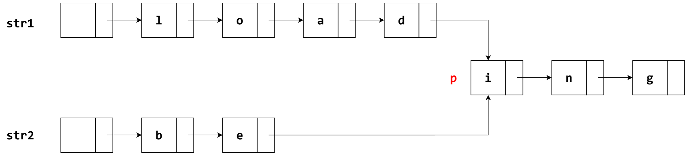

# 单链表应用

## Question 1

[2019]（15分）已知一个带有表头节点的单链表，节点结构为

| data | link |
|------|------|

假设该链表只给出了头指针 list。在不改变链表的前提下，请设计一个尽可能高效的算法，查找链表中倒数第k个位置上的结点（k为正整数）。
若查找成功，算法输出该节点的 data 域的值，并返回 1；否则，只返回 0。要求：
1. 描述算法的基本思想；
2. 描述算法的详细实现步骤；
3. 根据设计思想和实现步骤，采用程序设计语言描述算法（使用C、C++、或Java语言实现），关键之处请给出简要注释。

解：使用快慢指针来进行查找

## Question 2

[2012] 假定采用带头节点的单链表保存单词，当两个单词有相同的后缀时，则可共享相同的后缀存储空间。
例如，“loading”和“being”的存储映像如下图所示。

设 str1 和 str2 分别指向两个单词所在单链表的头节点，链表结点结构为

| data | next |
|------|------|

请设计一个时间上尽可能高效的算法，找出由 str1 和 str2 所指向两个链表共同后缀的起始位置（如图字符i所在结点的位置p）。要求：
1. 描述算法的基本设计思想；
2. 根据设计思想，采用 C 或 C++ 或 Java 语言描述，关键之处给出注释；
3. 说明你所设计算法的时间复杂度。

