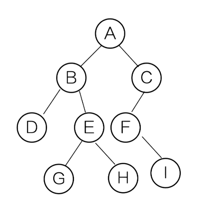
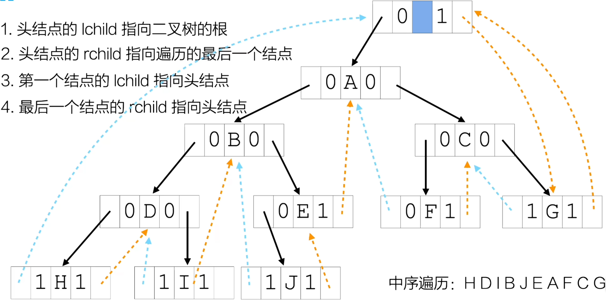

# 二叉树

## 基本性质

1. 二叉树的第 $i$ 层最多有 $2^{i-1}$ 个结点
2. 深度为 $k$ 的二叉树最多有 $2^k-1$ 个结点
3. 对于任何非空的二叉树 $T$，若叶子结点的个数为 $n_0$，度为2的结点个数为 $n_2$，则 $n_0 = n_2 + 1$

## 特殊二叉树

- 满二叉树：深度为 $k$，且含有 $2^k-1$ 个结点的二叉树
- 完全二叉树：深度为 $k$ 的、有 $n$ 个结点的二叉树，当且仅当其每一个结点都与深度为 $k$ 的满二叉树中编号从 1 至 n 的结点一一对应

## 二叉树遍历


- 前序遍历：ABDEGHCFI
- 中序遍历：DBGEHAFIC
- 后序遍历：DGHEBIFCA

## 根据遍历结果推导二叉树

已知前序遍历和中序遍历结果，可以唯一确定一棵二叉树

已知中序遍历和后序遍历结果，可以唯一确定一棵二叉树

已知前序遍历和后序遍历结果，**不能**唯一确定一棵二叉树

## 线索二叉树

```c++
typedef char ElemType;

typedef struct ThreadNode {
    ElemType data;
    struct ThreadNode *lchild;
    struct ThreadNode *rchild;
    int ltag;
    int rtag;
}ThreadNode;
```

