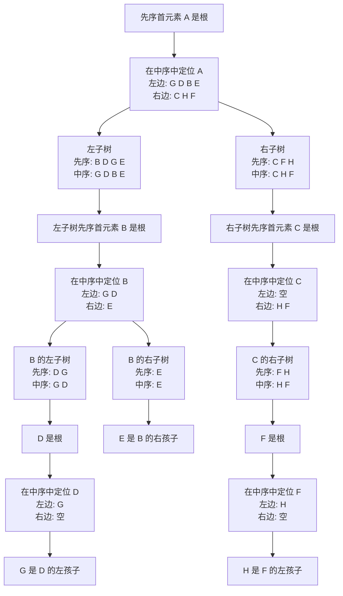
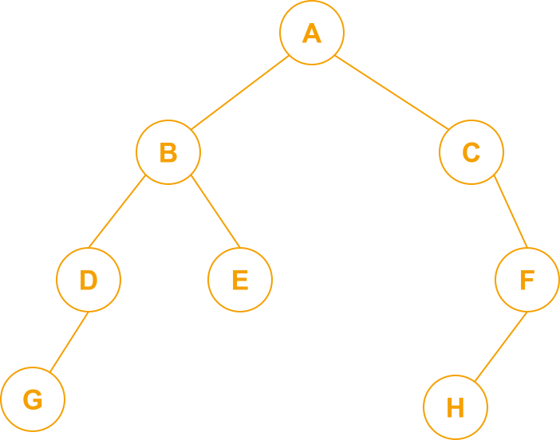
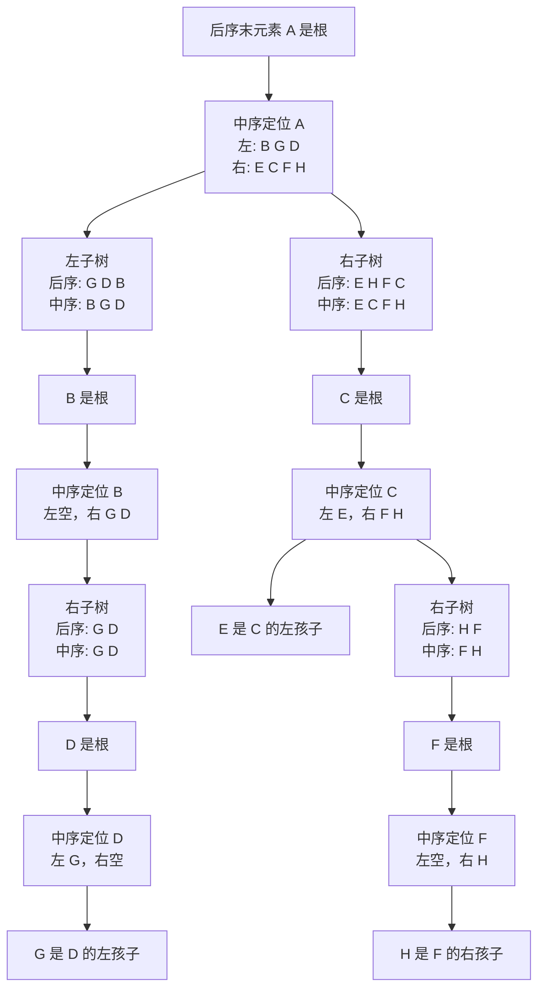
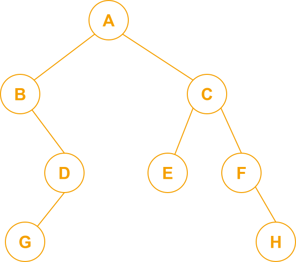
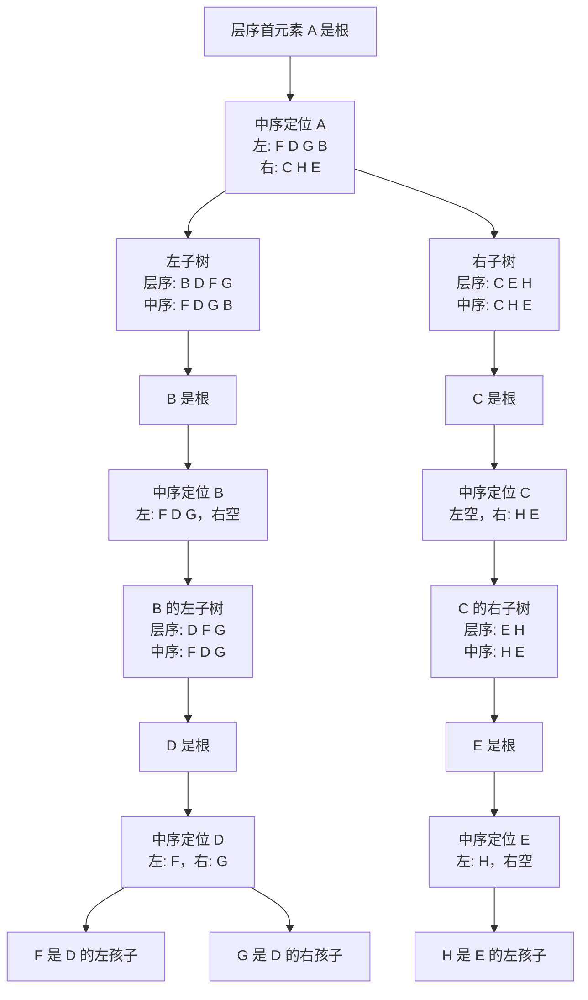
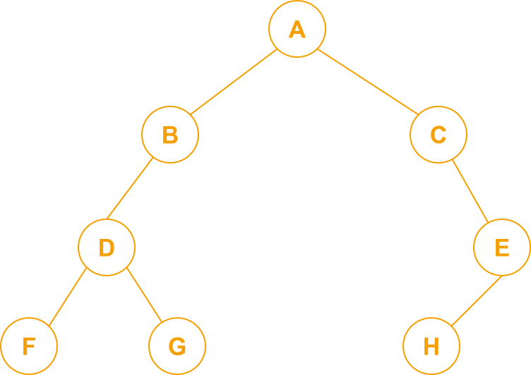

# 二叉树的构造

## 一、先序 + 中序

每次通过先序去找根结点，然后利用中序划分左右子树

先序：A B D G E C F H

中序：G D B E A C H F

结果：

## 二、后序 + 中序

每次通过后序去找根结点，然后利用中序划分左右子树

后序：G D B E H F C A

中序：B G D A E C F H

结果：

## 三、层序 + 中序

层序：A B C D E F G H

中序：F D G B A C H E

结果：

