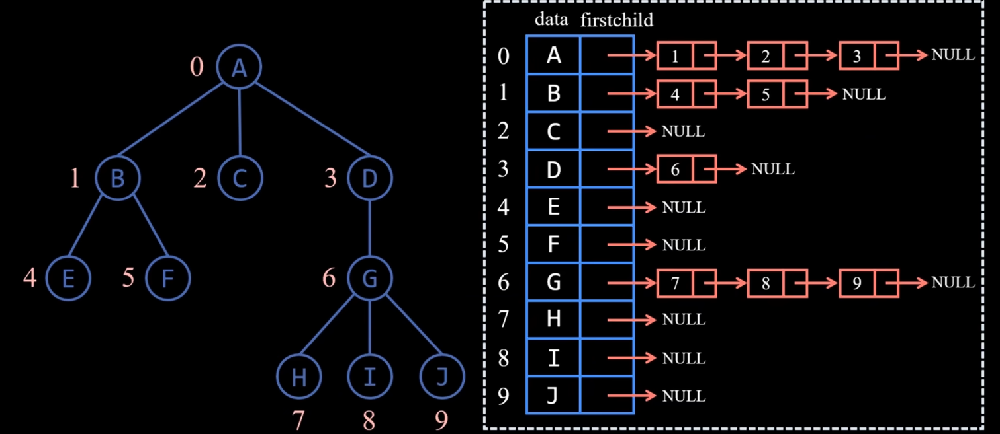

# 树的存储

## 双亲表示法

利用顺序存储，每个结构体存 `data` 和 `parent`的索引

找父亲很容易，找孩子很难

## 孩子表示法

顺序存储和链式存储相结合，很像图的邻接表，每个结构体存 `data` 和 `firstchild`链表

找孩子很容易，找父亲很难



## 孩子兄弟表示法

用二叉链表的形式存储，左孩子右兄弟

```c++
typedef struct Node {
    char data;
    struct Node *firstchild;  // 指向第一个孩子
    struct Node *nextsibling; // 指向右兄弟
}Node;
```