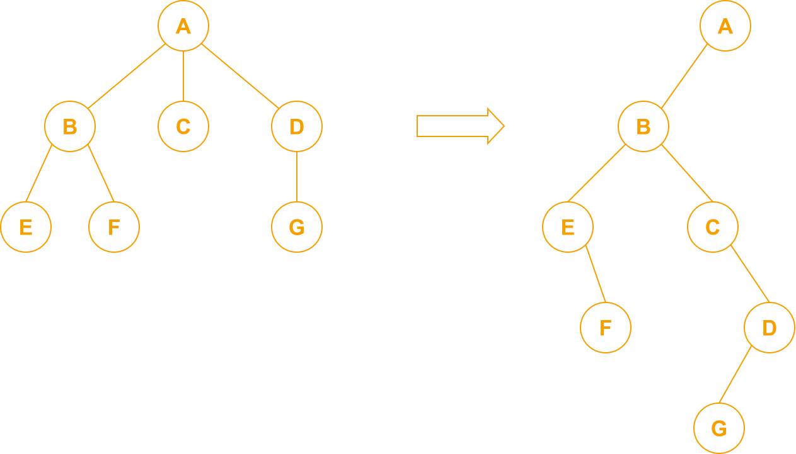
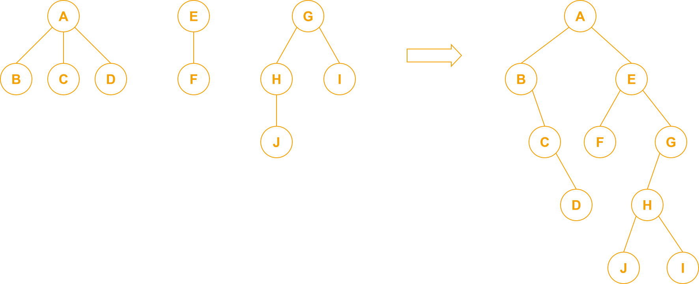

# 树与二叉树之间的转换

利用上节课的左孩子右兄弟来转换

# 树与森林之间的转换

森林 -> 二叉树：先依次把每棵树转换成二叉树，再把每棵二叉树的根接到前一个根的右指针上

二叉树 -> 森林：先从根开始沿着右指针拆成若干棵二叉树，再依次把每棵二叉树转换为树

# 树的遍历

## 1. 先根遍历

先访问根，再依次遍历每个子树

例子：上面第一个例子中的树： A B E F C D G

对树先根遍历 = 对相应的二叉树先序遍历

## 2. 后根遍历

先依次遍历每个子树，再访问根

例子：上面第一个例子中的树： E F B C G D A

对树后根遍历 = 对相应的二叉树中序遍历

# 森林的遍历

## 1. 先序遍历

依次对每棵树先根遍历

例子：上面第二个例子中的森林： A B C D E F G H J I

对森林先序遍历 = 对相应的二叉树先序遍历

## 2. 后序遍历（也叫中序）

依次对每棵树后根遍历

例子：上面第二个例子中的森林： B C D A F E J H I G

对森林后序（中序）遍历 = 对相应的二叉树中序遍历

