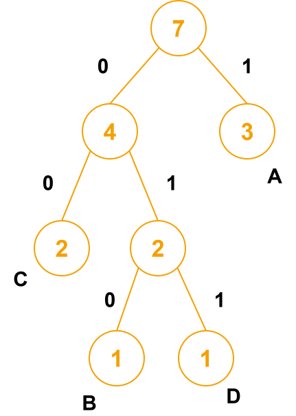

# 哈夫曼树

## 一、前言

如果我们想对 A B A A C D C 进行二进制编码，想当然可以有：

A:0 B:1 C:10 D:11

结果为 0100101110，但是会有歧义，不能推回去

如果采用等长编码，即

A:00 B:01 C:10 D:11

结果为 00010000101110，没有歧义，但是很浪费空间

所以我们采用哈夫曼编码，使得不出现歧义的情况下编出来的码的长度最短

## 二、构造哈夫曼树

核心思想：出现次数最多的字符，编码最短

构造方法：不断让出现次数最少的两个字符进行合并，生成父结点

上面的例子中，A有3次，B有1次，C有2次，D有1次

最后得到：

则编码分别为： A:1 B:010 C:00 D:011

最后编码结果为 1010110001100

## 三、树的带权路径长度 WPL

结点的带权路径长度：该结点到根之间的长度 × 该结点的权

树的带权路径长度WPL：所有叶子结点的带权路径长度之和

哈夫曼树也叫做最优二叉树，WPL最小