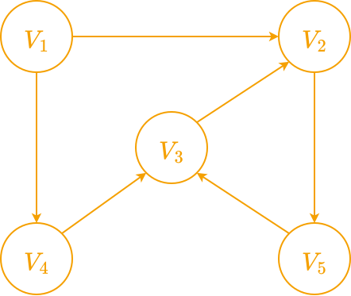
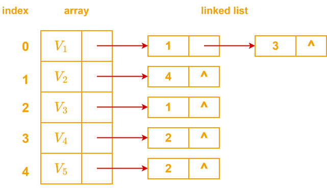

# 图的存储

## 一、邻接矩阵

### 有向图

比如 $V_1$ 到 $V_2$ 有边，则邻接矩阵的第1行第2列元素为1

结果：

$
\left( \begin{matrix}
0&		1&		0&		1&		0\\
0&		0&		0&		0&		1\\
0&		1&		0&		0&		0\\
0&		0&		1&		0&		0\\
0&		0&		1&		0&		0\\
\end{matrix} \right)
$

### 无向图

和有向图类似，不过无向图的邻接矩阵是一个对称矩阵

### 带权有向图和带权无向图

把邻接矩阵的 1 改成对应权值，0改成 $\infty$

## 二、邻接表

依旧使用上面的图，它的邻接表为

邻接表整体上看是一个数组，里面每个元素都是一个结构体（由一个顶点和一个链表构成），
链表用来存储与顶点有边的索引，链表顺序不唯一