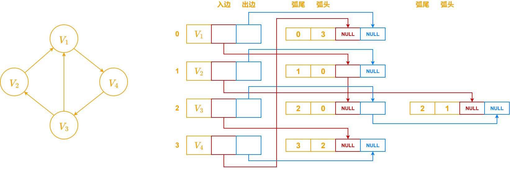
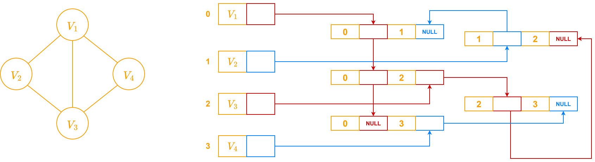

# 十字链表

为了解决**有向图**在邻接表中不方便计算入度的问题，引入十字链表

十字链表的边表分为入边表和出边表

- 入边表：弧头相同的边链接成的表
- 出边表：弧尾相同的边链接成的表

十字链表的表头结点由3个数据域组成
- `data` 记录该结点数据信息
- `firstIn` 指向以该结点为弧头的第一个弧结点
- `firstOut` 指向以该节点为弧尾的第一个弧结点

| data  | firstIn | firstOut |
|-------|---------|----------|
| 顶点域   | 入边表头指针  | 出边表头指针   |

十字链表边结点由5个数据域组成
- `info` 记录该结点的数据信息（可选）
- `tailVex` 弧尾结点的编号
- `headVex` 弧头结点的编号
- `headLink` 指向弧头相同的下一个弧结点
- `tailLink` 指向弧尾相同的下一个弧结点

| tailVex | headVex | headLink | tailLink |
|---------|---------|----------|----------|
| 弧尾域     | 弧头域     | 指针域      | 指针域      |

# 邻接多重表

邻接多重表用于存储**无向图**，解决无向图的邻接表一条边对应两个边结点的问题

邻接多重表一条边只对应一个边结点

邻接多重表头结点由2个数据域构成
- `data` 记录该顶点的数据信息
- `firstEdge` 指向第一条依附于该结点的边

邻接多重表（边表结点）有5个数据域构成
- `iVex` 第一个顶点的编号
- `iLink` 指向下一条依附于 `iVex` 顶点的边
- `jVex` 第二个顶点的编号
- `jLink` 指向下一条依附于 `jVex` 顶点的边
- `info` 记录该边结点的数据信息（可选）

