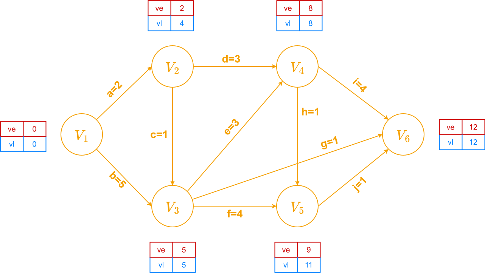

# 关键路径 · AOE 网

针对有向无环图（DAG），边上的权看作活动，就称边活动网（Activity on Edge Network）

每个顶点又叫做事件

整个有向无环图看作一个工程，完成所有工程至少需要花多长时间，也就是看哪条路径最耗时，
这条路径就是关键路径，路径上的边就是关键活动，关键活动不可拖延，其最早开始时间=最晚开始时间

利用拓扑求`ve`（事件的最早开始时间），利用逆拓扑求`vl`（事件的最晚开始时间）

## 方法

先求点：
- 拓扑求最早（找最大）
- 逆拓扑求最晚（找最小）

再求边：
- 边最早 = 发出点的最早
- 边最晚 = 指向点的最晚 - 边权

|       | ve | vl |
|-------|----|----|
| $V_1$ | 0  | 0  |
| $V_2$ | 2  | 4  |
| $V_3$ | 5  | 5  |
| $V_4$ | 8  | 8  |
| $V_5$ | 9  | 11 |
| $V_6$ | 12 | 12 |

|   | e | l  |
|---|---|----|
| a | 0 | 2  |
| b | 0 | 0  |
| c | 2 | 4  |
| d | 2 | 5  |
| e | 5 | 5  |
| f | 5 | 7  |
| g | 5 | 11 |
| h | 8 | 10 |
| i | 8 | 8  |
| j | 9 | 11 |
