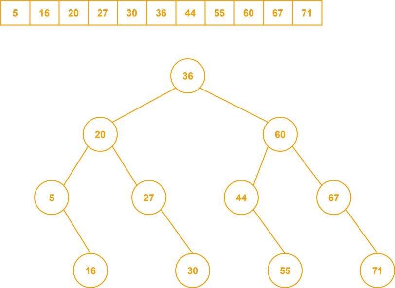
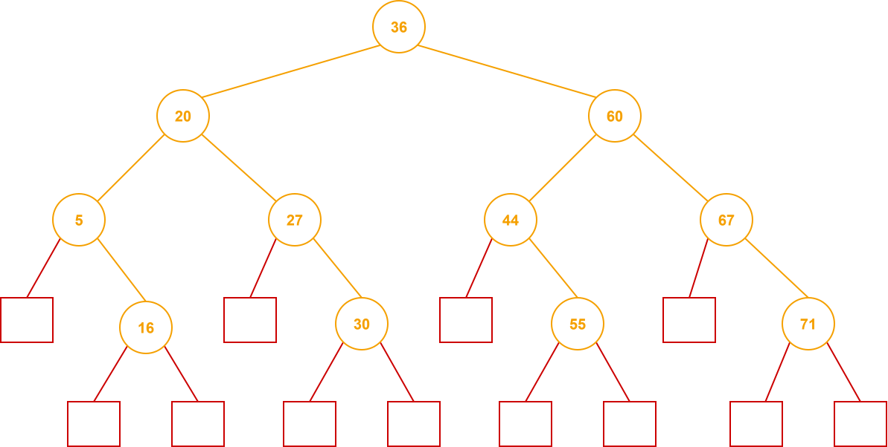

# 折半查找

条件：必须是顺序表、必须有序

时间复杂度：$O(\log_2 n)$

## 折半查找判定树



## ASL 查找成功

对于上面的例子，成功 = (1 + 2 × 2 + 4 × 3 + 4 × 4) × 1/11 = 3

## ASL 查找失败

看判定树的外部结点



失败 = (4 × 3 + 8 × 4) × 1/12 = 11/3


# 例题：LeetCode 852

给定一个长度为 `n` 的整数山脉数组 `arr`，其中的值递增到一个峰值元素然后递减。

返回峰值元素的下标。

你必须设计并实现时间复杂度为 $O(log_2 n)$ 的解决方案。

## 解法

比较中间元素和它的下一个元素，判断当前处于上升还是下降段

```c++
int peakIndexInMountainArray(int* arr, int arrSize) {
    int left = 0;
    int right = arrSize - 1;
    while (left < right) {
        int mid = (left + right) / 2;
        if (arr[mid] < arr[mid + 1]) left = mid + 1;
        else right = mid;
    }
    return left;
}
```