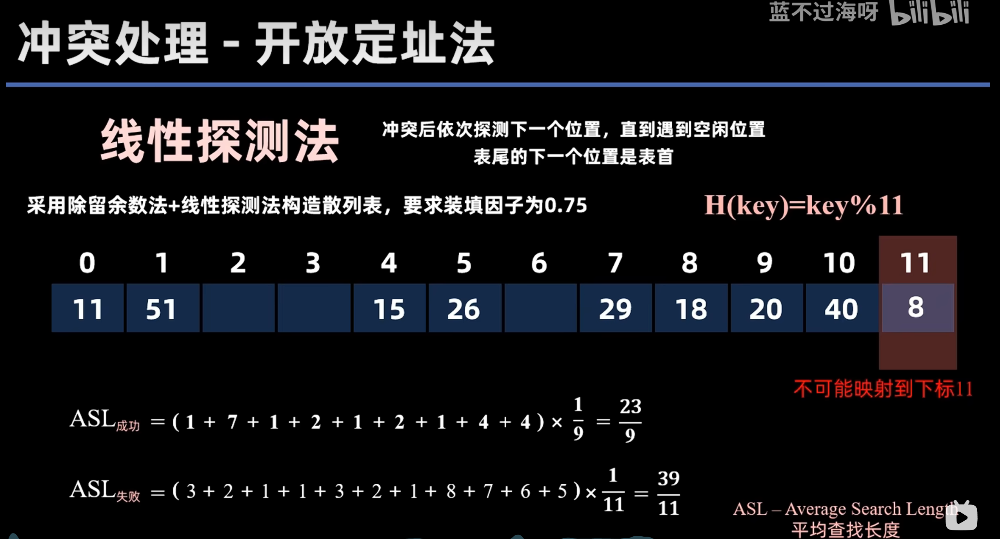

# 散列表（哈希表）

装填因子 $\alpha$ = 表中元素数 / 表长，装填因子越大，发生冲突越大

## 散列函数

关键字（key）与数组下标（地址）之间的映射关系

- 直接定址法：适合关键字基本连续的情况，否则会出现大量空间浪费
  - $H(\text{key})=\text{key}$ 或 $H(\text{key})=a \times \text{key} + b$
- 除留余数法：求余操作可以把不连续的关键字映射到连续的地址空间，但是可能出现冲突
  - $H(\text{key}) = \text{key} \% p$ （p一般取小于等于表长的最大质数）

## 冲突处理 - 开放定址法

### 线性探测法：

冲突后依次探测下一个位置，直到遇到空闲位置，表尾的下一个位置是表首

计算AVL：

直接删除某个元素可能会截断其他元素的查找路径，可以增加一个删除标记

### 平方探测法：

冲突时按照 +1²，-1²，+2²，-2²，+3²，+3²，……的顺序进行探测

表长 = 某个4k+3的质数

## 冲突处理 - 拉链法

数组的每个空间单独维护一个链表指针，如果有冲突的话用头插法或者尾插法串一起即可
