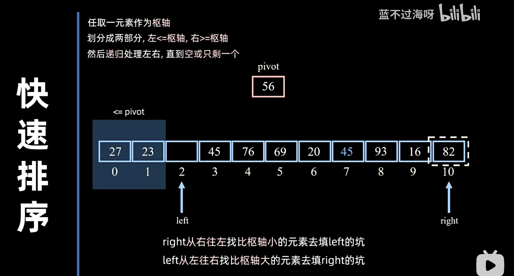

# 交换排序大类

## 1.冒泡排序（Bubble Sort）

每轮从前往后依次比较相邻的两个，如果逆序则进行交换

每轮排好1个元素，最多需要n-1轮

每轮都会少比较一对

注意：交换一次需要用一个`temp`变量，元素需要移动三次

### 稳定性

冒泡排序是稳定的

### 改进

如果前面已经有序，则没有必要进行比较

用一个`flag`变量来标记某一轮是否发生过交换，每轮开始设为 `false`

如果某轮过后`flag`仍为`false`，说明已经有序

### 效率分析

- 时间复杂度最好：$O(n)$
- 时间复杂度最坏：$O(n^2)$
- 时间复杂度平均：$O(n^2)$
- 辅助空间复杂度：$O(1)$

## 2.快速排序（Quick Sort）

任取一元素作为枢轴，用一个变量`pivot`存放枢轴元素

用挖坑法的话，就取第一个元素作为`pivot`，方便后面`left`和`right`的移动

### 稳定性

快速排序是不稳定的

### 效率分析

看似没有开辟新空间，但是递归是需要栈空间的

- 时间复杂度最好：$O(n \log_2 n)$
- 时间复杂度最坏：$O(n^2)$
- 时间复杂度平均：$O(n \log_2 n)$
- 辅助空间复杂度最好：$O(\log_2 n)$
- 辅助空间复杂度最坏：$O(n)$
- 辅助空间复杂度平均：$O(\log_2 n)$